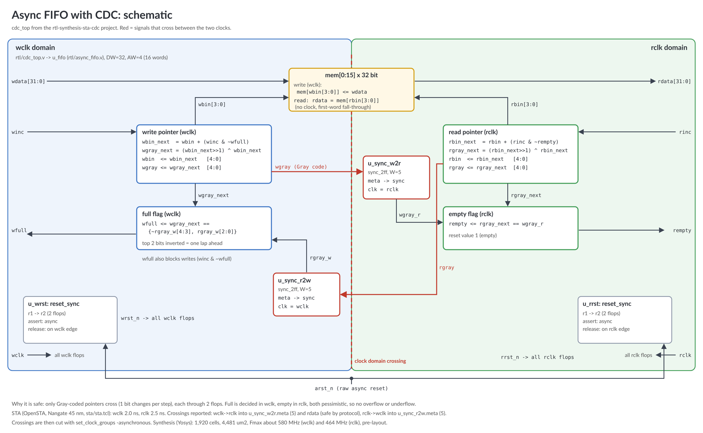

# RTL to timing: CDC block, synthesis and STA

A small front-end flow with free tools, from RTL to a timed gate-level
netlist. I made it to practise CDC, synthesis and STA scripts:

- an async FIFO between two unrelated clocks (Gray pointers, 2-flop
  synchronizers) plus reset synchronizers (async assert, sync release)
- cocotb tests with a Python model, run with three clock ratios
- Yosys synthesis to the Nangate 45 nm open cell library (TCL script)
- OpenSTA timing with SDC constraints. The script first lists every clock
  domain crossing, then cuts them with `set_clock_groups`, then searches
  for Fmax.

I also ran the same flow on `mac_accel.v`, the MAC accelerator from my
[RISC-V project](https://github.com/madihaanjumshahzad-creator/RISC-V_near_memory_MAC) (an earlier
version of the file is in `rtl/`).



## Results

| Block | Cells | Area (um2) | Constrained period | Setup slack | Fmax (pre-layout) |
|---|---:|---:|---|---:|---:|
| cdc_top (16 x 32-bit FIFO) | 1,920 | 4,481 | wclk 2.0 ns, rclk 2.5 ns | +0.344 ns | wclk 580 MHz, rclk 464 MHz |
| mac_accel (64-word scratchpad) | 14,695 | 27,660 | 5.0 ns | +0.521 ns | 223 MHz |

Typical corner, ideal clocks, no wire load, so these are synthesis
numbers, not post-layout.

Clock domain crossings found by STA before they are cut:

- `wclk -> rclk`: 5 endpoints in `u_sync_w2r.meta[*]` (write pointer, Gray)
  plus the 32 `rdata` outputs (memory read, safe because the read pointer
  never passes the synchronized write pointer).
- `rclk -> wclk`: 5 endpoints in `u_sync_r2w.meta[*]` (read pointer, Gray).

There is no other crossing, so each one ends in a synchronizer or is
covered by the FIFO protocol.

## What I found in the reports

1. **Fanout limits mac_accel.** The scratchpad is built from 2,424
   flip-flops because there is no SRAM macro in this flow. The scratchpad
   address flop drives about 900 gates, and ABC cannot buffer a flop
   output, so this one net sets Fmax. In a real chip the scratchpad is an
   SRAM macro, and buffering is done during placement (for example
   `repair_design` in OpenROAD). Duplicating the address register in RTL
   is another fix.
2. **Removal check fails in cdc_top (-0.158 ns).** The reset synchronizer
   output goes straight to the RN pin of the next flops with zero wire
   delay and ideal clocks. The DFFR removal time (0.287 ns) is larger than
   the clock-to-Q delay. After clock tree synthesis and hold fixing this
   is normally solved by the reset tree buffers; here it is left visible
   on purpose.
3. **Simulation does not show metastability.** The cocotb tests check the
   FIFO logic and protocol with unrelated clocks, but RTL simulation never
   goes metastable. The synchronizers are there for silicon, and the
   STA crossing report is the check that none is missing.

## Run it

Tools (all free): Icarus Verilog, Verilator, cocotb, Yosys and OpenSTA.
I used Ubuntu 24.04 on WSL (Windows):

```
sudo apt-get install iverilog verilator yosys
pip install cocotb==1.9.2
# OpenSTA is not packaged; build it once (about 10 minutes), see BUILD_OPENSTA.md
make lib     # download the Nangate 45 nm library
make all     # lint, simulation, synthesis, STA
```

Reports are written to `build/`:
`<top>_area.rpt`, `<top>_netlist.v`, `<top>_timing.rpt`.

## Files

```
rtl/sync_2ff.v          two-flop synchronizer
rtl/reset_sync.v        reset synchronizer
rtl/async_fifo.v        async FIFO, Gray pointers
rtl/cdc_top.v           FIFO + reset synchronizers (synthesis top)
rtl/mac_accel.v         MAC accelerator from the RISC-V project
tests/                  cocotb tests
syn/synth.tcl           Yosys flow
sta/sta.tcl             OpenSTA flow: CDC report, slack, Fmax search
constraints/*.sdc       clocks, I/O delays, false paths, clock groups
```

## To do

- [ ] Clock gating on the FIFO write side (integrated clock gate cell)
      and a power report
- [ ] Duplicate the scratchpad address register and re-time mac_accel
- [ ] Gate-level simulation of the synthesized netlist
- [ ] Scan insertion (DFT) on cdc_top
- [ ] Place and route with OpenROAD and compare post-layout timing

## Credits

Nangate 45 nm Open Cell Library (downloaded by `make lib`, not stored here).
FIFO design follows C. Cummings, "Simulation and Synthesis Techniques for
Asynchronous FIFO Design", SNUG 2002.
MIT license, (c) 2026 Madiha Anjum.
